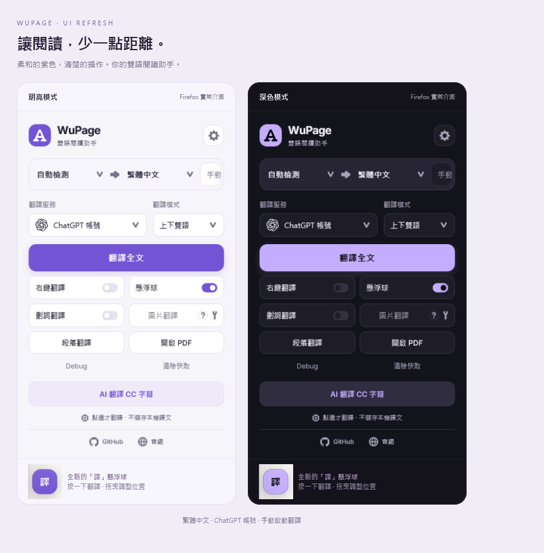
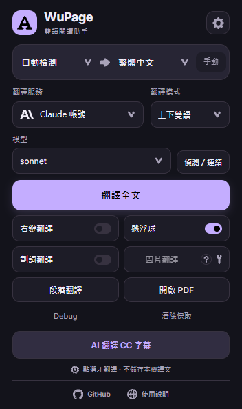

# WuPage Codex 翻譯 · Chrome／Firefox

繁體中文網頁雙語翻譯擴充套件。按下翻譯後，由**使用者自己電腦上的 Codex、Gemini CLI 或 Claude Code**，使用安裝者自己的登入帳號處理，不需要填入 API 金鑰。這些是官方本機命令列工具；不會自動操作桌面聊天視窗，也不會直接共用桌面聊天程式的登入。

這是 [mr-wuliu/wupage](https://github.com/mr-wuliu/wupage) 的非官方衍生 **fork**，保留原作者的提交歷史。`codex-firefox` 是本改版分支，同時提供 Chrome 與 Firefox 版，加入本機帳號橋接、繁體中文介面、紫色明暗主題與 YouTube AI 雙語字幕；`main` 保留上游版本供後續同步。不是 OpenAI 或原專案的官方產品。



[下載擴充與橋接](https://github.com/kiwimana/wupage-codex-translator/releases/latest) · [問題回報](https://github.com/kiwimana/wupage-codex-translator/issues)

## 桌面帳號翻譯：不保留一般本機聊天紀錄

**翻譯採用獨立的臨時工作，不續接原本的聊天室，也不把譯文保存為永久本機聊天紀錄。** 這裡所說的「沒有紀錄的聊天室」是由官方本機工具執行的臨時翻譯工作，不需要打開可見的聊天視窗；各服務的做法如下。

| 本機工具 | 本機對話紀錄的處理 | 實作範圍 |
| --- | --- | --- |
| Codex／ChatGPT 帳號 | 每批使用 `codex exec --ephemeral`，不保存此次工作階段的對話檔案。 | 使用官方臨時執行模式，不續接既有對話。 |
| Claude Code／Claude 帳號 | 每批使用 `--no-session-persistence`，不將此次對話保存到磁碟供日後續接。 | 停用本機對話保存，不續接既有對話。 |
| Gemini CLI／Google 帳號 | 每批使用全新的獨立暫存目錄；正常完成、錯誤或取消時清理此次目錄。 | 執行期間仍可能有暫存對話檔，不能稱為「從不寫入紀錄」或官方無痕聊天室。強制終止或斷電可能留下暫存。 |

Codex 與 Claude 的不保存模式，和 Gemini 的「暫存後清理」有差異；不將它們統稱為官方無痕聊天視窗。以上只說明本機翻譯工作，不承諾雲端服務零留存，也不刪除使用者原有聊天、設定或登入資料。擴充另停用永久本機譯文快取，避免長期累積翻譯內容。

官方說明：[Codex 臨時執行](https://developers.openai.com/codex/noninteractive/)、[Claude 對話保存參數](https://code.claude.com/docs/en/cli-reference)、[Gemini 工作階段管理](https://geminicli.com/docs/cli/session-management/)。實作細節見[本機橋接說明](native-chatgpt/README.md)與[隱私說明](PRIVACY.md)。

## 功能

- 網頁全文及段落翻譯，原文與譯文上下對照。
- 可拖曳的「譯」懸浮球，包含語言、服務與功能選單。
- YouTube CC 與齒輪之間的 AI 按鈕，依目前字幕與目標語言顯示雙語字幕；再按一次停止。
- Shorts 字幕工具列避開原生控制按鈕。
- 明暗主題、設定頁及 PDF 工作區。
- 三個帳號服務分別選模型，支援「自動」、預設模型及自訂模型名稱；小視窗可快速切換。
- 設定頁提供「偵測本機工具」及獨立的「連結帳號」按鈕，預設不偵測、不登入。找到工具不代表已登入。
- 自動檢查 GitHub 穩定版；Chrome 可透過本機橋接自動安裝，Firefox 臨時載入版提示下載與重新載入。
- 預設手動啟動，停用永久本機譯文快取；Codex 與 Claude 停用此次對話保存，Gemini 使用獨立暫存並於完成、錯誤或取消後清理。

## 資料會送去哪裡？

```text
你的 Chrome／Firefox → 你本機的原生橋接 → 你選的本機工具 → 該工具的雲端服務
```

公開套件沒有作者的登入資料、API 金鑰、Cookie、Windows 使用者路徑、遠端桌面、代理伺服器或通道設定。原生橋接使用程序標準輸入輸出，不開設 HTTP 服務，也不會連回作者電腦。每次安裝都在安裝者電腦上產生自己的程式路徑設定及目前 Windows 使用者的登錄項目。

翻譯計入安裝者自己所選帳號與模型的可用額度。這是雲端翻譯；本機紀錄清理不代表服務端零留存。指定模型不可用時顯示錯誤，不自動改用另一服務或作者帳號。詳見[隱私說明](PRIVACY.md)。

## Chrome 安裝（Windows）

需要 Chrome 127+、Node.js 22+，以及至少一個本機工具：Codex、Gemini CLI 或 Claude Code。使用者自行安裝工具與登入，單純載入擴充不會連結帳號或翻譯。

1. 從 [Releases](https://github.com/kiwimana/wupage-codex-translator/releases/latest) 下載 **`chrome.zip` 結尾**的擴充包與 **`windows-bridge.zip` 結尾**的橋接包，分別解壓縮到固定資料夾。
2. Chrome 網址列輸入 `chrome://extensions`，開啟右上角「開發人員模式」。
3. 按「載入未封裝項目」，選擇 Chrome 擴充解壓縮後、含根 `manifest.json` 的資料夾。
4. 在橋接解壓縮資料夾執行：

   ```powershell
   powershell.exe -NoProfile -ExecutionPolicy Bypass -File .\install.ps1 -Browser Chrome
   ```

5. 將 WuPage 釘選到工具列。開啟小視窗選服務與模型，按「偵測／連結」到設定頁；先手動偵測，再自行決定是否連結帳號。按「測試服務」才會送出短句並使用少量額度。
6. 重新整理要翻譯的網頁，再按「翻譯全文」、懸浮球或 YouTube 的 AI 按鈕。

Chrome 版使用公開金鑰固定開發版識別碼 `lfhpgjnpadlfkafdnbeepfpjhfbdjblb`，橋接僅允許這個精確來源；請保留 `manifest.json` 的 `key`。此公開金鑰只供擴充識別，不是帳號登入金鑰，也不是作者電腦連線資訊。此版以開發人員模式安裝，尚未發布 Chrome 線上應用程式商店。



## Firefox 安裝（Windows）

需要 Firefox 154+、Node.js 22+，以及至少一個所選工具：Codex、Gemini CLI 或 Claude Code。帳號與可用模型依各工具的方案限制。

1. 從本儲存庫的 **Releases** 下載 Firefox 擴充 ZIP 與 Windows 橋接 ZIP，分別解壓縮到固定資料夾。
2. 安裝你要使用的官方工具：[Codex](https://developers.openai.com/codex/cli/)、[Gemini CLI](https://geminicli.com/docs/get-started/installation/) 或 [Claude Code](https://code.claude.com/docs/en/setup)。可以先不登入，完成安裝後再透過擴充的連結按鈕開啟登入。
3. 在橋接資料夾執行：

   ```powershell
   powershell.exe -NoProfile -ExecutionPolicy Bypass -File .\install.ps1
   ```

   從原始碼安裝時改用 `.\native-chatgpt\install.ps1`。可加 `-Browser Firefox` 只註冊 Firefox；不指定時支援兩種瀏覽器。可用 `-CodexPath`、`-ClaudePath`、`-GeminiPath` 指定自己的工具完整路徑；Gemini 也支援套件的 JavaScript 入口。Node.js 可用 `-NodePath` 指定。更新此版本時也要更新橋接來源並重跑安裝程式。

4. Firefox 開啟 `about:debugging#/runtime/this-firefox`，選「載入暫用附加元件」，載入擴充 ZIP 解壓縮後的 `manifest.json`。
5. 在小視窗選擇服務及模型；按「偵測／連結」前往設定。先按「偵測本機工具」，找到工具後再按「連結帳號」：Codex 使用 `codex login`；Claude 使用 `claude auth login`；Gemini 在互動視窗選 `Login with Google`。偵測與開啟登入視窗都不等於帳號已通過驗證；只有手動按「測試服務」才送出短句驗證，並使用少量額度。
6. 重新整理網頁，選擇目標語言，按「翻譯全文」或頁面的「譯」。未按翻譯、測試或連結時，不會主動啟動工具。

發布包未經 Mozilla 簽章，暫用擴充在關閉 Firefox 後需要重新載入。目前附帶橋接安裝程式僅支援 Windows；macOS／Linux 需要另行實作原生主機註冊及啟動器。

## 擴充自動更新

**v1.9.1 是第一次提供更新功能的版本。** 舊版請先手動下載新版擴充與橋接；之後可由小視窗底部的版本按鈕，或設定頁「擴充更新」管理更新。

- 預設每 6 小時向本儲存庫 GitHub Release 檢查穩定版，可關閉；也可按「立即檢查」。小視窗會提示新版，不會送出網頁內容或啟動 AI 登入。
- **Chrome 自動安裝**：先將新版橋接解壓到原橋接資料夾，執行下列指令（把路徑換成在 `chrome://extensions` 載入的擴充資料夾），再到設定頁開啟「自動安裝 Chrome 更新」。預設不自動覆寫檔案。

  ```powershell
  powershell.exe -NoProfile -ExecutionPolicy Bypass -File .\install.ps1 -Browser Chrome -ChromeExtensionPath "D:\WuPage\chrome"
  ```

  這必須是只存放擴充檔案、含 `manifest.json` 的獨立資料夾；請保持 Chrome「開發人員模式」開啟，才能重新載入開發版。更新只替換這個指定資料夾，保留瀏覽器裡的翻譯偏好與模型設定，不更新橋接或讀取 AI 登入資料。擴充會在沒有正在執行的翻譯工作時安裝，並等工作結束後重新載入；原本開著的網頁請重新整理。也可手動按「安裝更新」。
- **Firefox 臨時載入版**：自動檢查並提示新版本；下載 Firefox ZIP、解壓覆蓋原擴充資料夾，再到 `about:debugging#/runtime/this-firefox` 按「重新載入」。目前沒有 Mozilla 簽署包，不能宣稱會像商店擴充一樣自動安裝。

下載只使用本專案的 GitHub 穩定 Release，核對版本、Chrome 識別碼與 SHA-256，解壓到隔離目錄後再替換，失敗時保留或還原原檔。不接受網頁提供的下載網址或檔案路徑。這是本機橋接協助更新開發版，並非 Chrome 商店自動更新；[Chrome 說明](https://developer.chrome.com/docs/extensions/how-to/distribute/host-on-linux)、[Firefox 更新說明](https://extensionworkshop.com/documentation/manage/updating-your-extension/)。

## YouTube 雙語字幕

同一播放器只會有一個 AI 按鈕。切換影片、廣告、重建或複製控制列時會清理舊按鈕，避免多個 AI 按鈕重疊。

v1.9.2 避免舊、新內容腳本反覆搬動按鈕，並略過與控制列無關的字幕、進度變動。**更新後請重新整理已開啟的 YouTube 分頁**，讓舊監測結束。若未開啟翻譯仍卡頓，可在 Firefox 的 `about:processes` 查看分頁與擴充的負載，並比較暫停擴充、重新整理後的播放情況；操作見 [Firefox 工作管理員說明](https://support.mozilla.org/en-US/kb/task-manager-tabs-or-extensions-are-slowing-firefox)。

先選取英文或其他語言 CC，再點播放器右下的「AI」開啟選單。選「僅本次開啟字幕翻譯」只處理目前影片；翻譯中同一列改為「停止本次字幕翻譯」。擴充小視窗的「AI 翻譯 CC 字幕」仍可直接啟動。字幕準備時顯示載入圓圈，預設切換影片不會自行開始。

長影片與 Shorts 統一使用 **AI 字幕**按鈕：左鍵開啟／收合選單，右鍵開啟選單。第一層可直接調整翻譯語言與字幕大小：

- **此網站自動翻譯**：記住此網站，自動翻譯後續影片。預設關閉，更新不會替你開啟；YouTube 首頁預覽不會自動翻譯。關閉後下次影片恢復手動，當前影片可選「停止本次字幕翻譯」。
- **僅本次開啟字幕翻譯**：開始／停止目前影片，保留網站自動規則。
- **下載字幕**：原文、已完成譯文或雙語，支援 SRT／WebVTT。下載不會額外啟動整部影片翻譯；譯文只有已完成並保留於記憶體的部分，即時字幕的時間是估計值。
- **字幕設定**：目標語言、服務、原字幕語言；原文與譯文字體大小、字體、字重、字色、上下排列、原文顯示、共用黑色圓角底板、背景不透明度與字幕高度。外觀調整不重新翻譯，可一鍵還原外觀。
- 按 Esc、關閉按鈕或點選單外即可關閉。也可先聚焦 AI 按鈕，再按 Shift+F10 或鍵盤選單鍵。

開啟選單或調整字幕外觀不會開始翻譯。字幕來源、服務、字體、字色、時間偏移與匯入 SRT／VTT 在字幕設定的「字幕來源與進階樣式」。Shorts 的選單在有空間時放到影片外側，字幕預留底部資訊區；窄視窗與全螢幕會將選單限制於視窗內。下載暫存只留在目前影片的記憶體，切換影片或離開分頁時清除；只有按下下載才產生本機檔案。設計改進見[播放器操作比較](docs/youtube-ui-review.md)。

在「字幕設定 → 字幕來源與進階樣式 → 字幕處理」可分別開關：

- **優先人工字幕**（預設開啟）：在播放器目前的語言內優先採用人工原字幕。若有可讀取且明確標記為人工的目標語言譯文，就直接顯示雙語，不送 AI；找不到或讀取失敗則使用原本的 AI 翻譯。繁中與簡中分開比對，手動指定的原字幕仍優先。此來源辨識目前支援 YouTube／Bilibili 字幕目錄；不把來源不明的字幕猜成人工。人工譯文時間有空白時不會為此暫停影片或追加 AI 工作。
- **基本分句最佳化**（預設開啟）：在本機合併英文自動字幕的相鄰片段、處理累加重複，依標點及長度拆句並估算子句時間。限制合併長度與時長，不改人工字幕、其他語言或匯入字幕，也不重新切分只能讀到畫面文字的即時字幕。不是 AI 智慧分句，不新增模型請求。
- **只翻譯對話內容**（預設關閉）：略過常見的音樂、掌聲、笑聲等音效註記，支援字幕檔及即時畫面字幕。保留不確定的括號內容、說話者名稱與歌詞；只含已辨識音效的片段不送翻譯。原文字幕下載保持原始文字，譯文／雙語下載使用已套用處理的內容。

這些開關不會在未啟用字幕翻譯時自行開始工作；修改已啟用影片的處理規則會取消舊工作並重新套用，避免混入舊譯文。還原「字幕外觀」不會重設上述內容規則。

影片須提供可讀的文字字幕，不會擷取音訊或辨識畫面內字幕。AI 準備字幕時可能暫停影片，譯文準備完成後繼續；原本已暫停的影片保持暫停。

## 修復與移除

- `No such native application`：重新執行橋接的 `repair.cmd` 或 `install.ps1`，完整退出並重開 Firefox，重新載入暫用擴充，再重新整理頁面。
- `spawn … codex.exe ENOENT`：Codex 更新後可能已刪除原本的版本資料夾。使用 v1.9.4 或更新的本機橋接，偵測與翻譯會自動尋找仍有執行檔的已安裝版本；更新尚未完成時，等待 Codex 正常開啟後按「重試讀取」。此修正需要更新橋接，單獨更新瀏覽器擴充不會更新橋接程式。
- 移動橋接資料夾或更新 Codex 後找不到程式：重新執行安裝程式，依新本機位置產生設定。
- 移除：在原橋接資料夾執行 `uninstall.ps1`，再卸載擴充。可加 `-Browser Chrome` 或 `-Browser Firefox` 只移除對應瀏覽器註冊；只移除路徑相符的本次安裝，不刪除帳號登入或聊天。
- 不要複製別人的 `bridge.config.json`、產生的主機 JSON 或 Codex 登入檔；請在自己的電腦重新執行安裝程式。

## 從原始碼建置

```powershell
npm ci
npm run typecheck
npm test
npm run test:native
npm run build:firefox:codex
npm run build:chrome:codex
npm run package:codex
```

擴充輸出位於 `dist-chrome-chatgpt/` 與 `dist-firefox-chatgpt/`，發布 ZIP 位於 `artifacts/`。建置不需要帳號登入或 API 金鑰。詳見[公開版開發說明](docs/codex-development.md)。

## 來源與授權

原始專案與第三方資源來源見 [UPSTREAM.md](UPSTREAM.md)，保留原有第三方授權文件。本儲存庫未替原始專案宣告新的授權。[原版說明](docs/upstream-readme.md)保留為來源參考。
